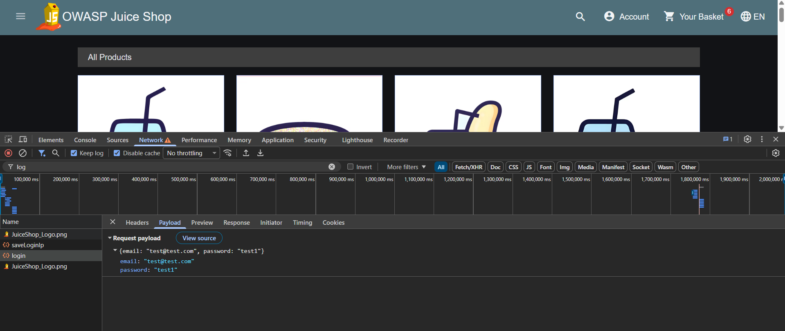

| ID | Заголовок | Критичность | Приоритет | Предусловия | Шаги воспроизведения | Ожидаемый результат | Фактический результат | Приложения |
| --- | --- | --- | --- | --- | --- | --- | --- | --- |
| BUG-02 | Пароль отображается в открытом виде в запросе Payload после успешной авторизации | Major | High | 1. Открыта страница авторизации OWASP Juice Shop 2. DevTools открыт на вкладке Network (включена галочка Preserve log) 3. Существует тестовый пользователь test@test.com с паролем test1 | 1. Открыть Chrome DevTools → вкладка Network 2. Ввести в форму логин test@test.com и пароль test1 3. Нажать кнопку «Log In» 4. В списке запросов найти POST-запрос на /rest/user/login 5. Открыть вкладку Payload (или Request) 6. Посмотреть значение поля password | Пароль в Payload отображается в виде хэша или зашифрованной строки. Открытый текст пароля недоступен | Пароль в Payload отображается в открытом виде (plain text) — "password": "test1". Любой, кто имеет доступ к DevTools, может увидеть пароль |  |