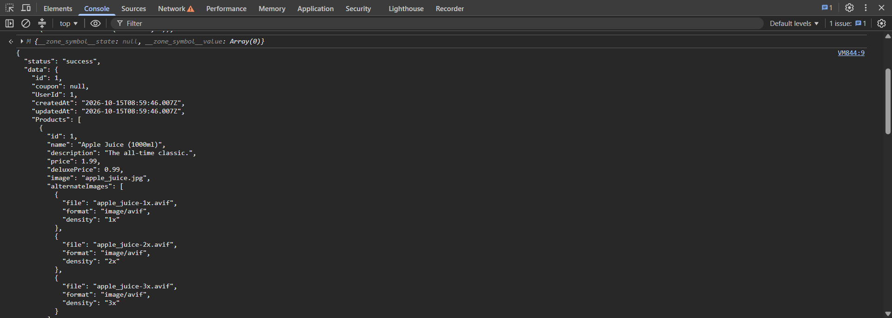

| ID | Заголовок | Критичность | Приоритет | Предусловия | Шаги воспроизведения | Ожидаемый результат | Фактический результат | Приложения |
| --- | --- | --- | --- | --- | --- | --- | --- | --- |
| BUG-03 | IDOR в /rest/basket/{id} позволяет читать содержимое чужих корзин | Critcal | High | 1. Пользователь авторизован под test@test.com 2. В Local Storage сохранен валидный JWT-токен 3. Известен ID своей корзины (6) и ID чужой корзины (1) | 1. Открыть DevTools → вкладка Network 2. В приложении добавить любой товар в корзину 3. В списке запросов найти GET /rest/basket/6 4. Скопировать запрос как fetch (правая кнопка → Copy → Copy as fetch) 5. Открыть вкладку Console, вставить скопированный код 6. Изменить ID в URL с 6 на 1 7. Выполнить запрос 8. Проверить ответ сервера | Сервер возвращает 403 Forbidden или 401 Unauthorized. Доступ к корзине другого пользователя запрещен | Сервер вернул 200 OK и JSON-объект с данными корзины пользователя с UserId: 1. В корзине отображаются товары, не принадлежащие текущему пользователю (test@test.com) |  |